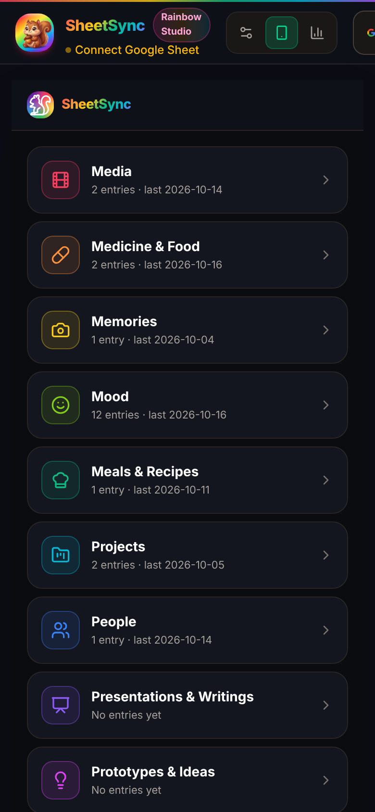
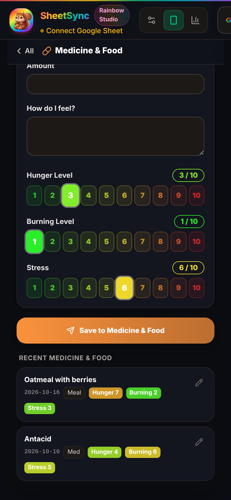
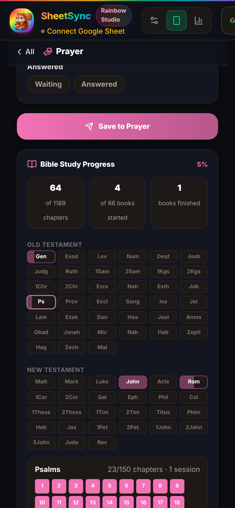
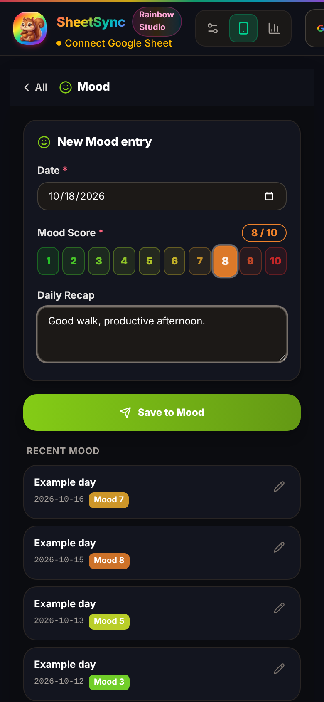
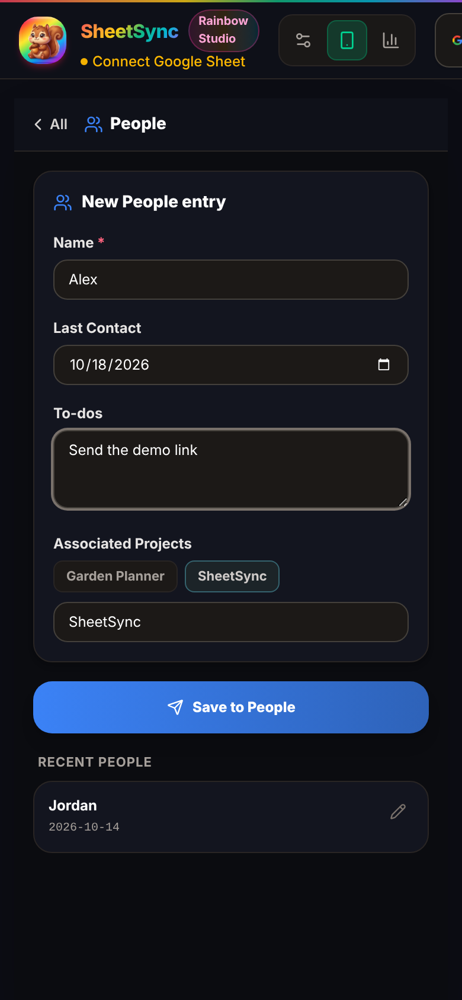
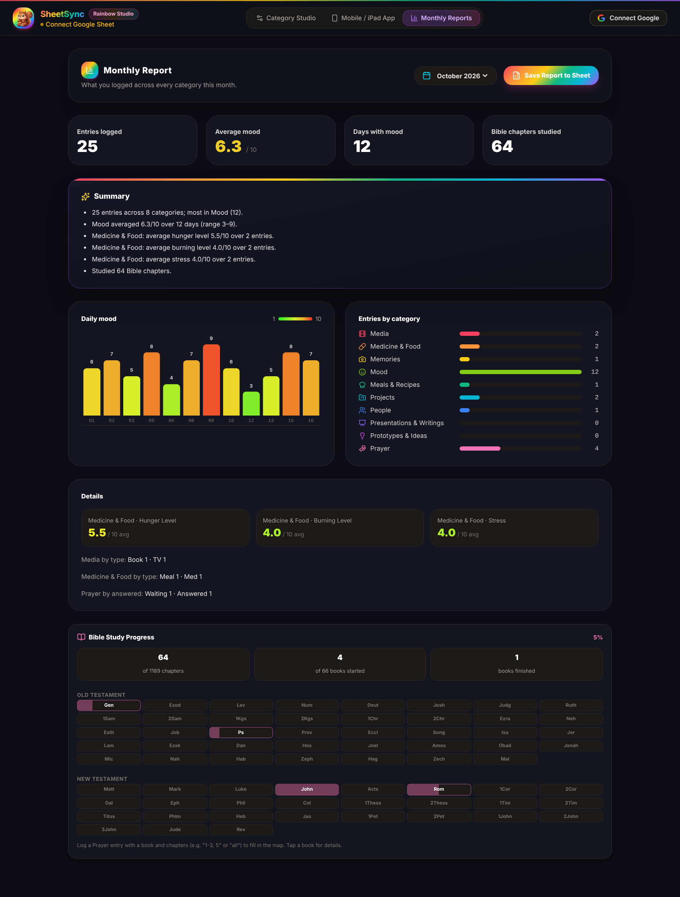
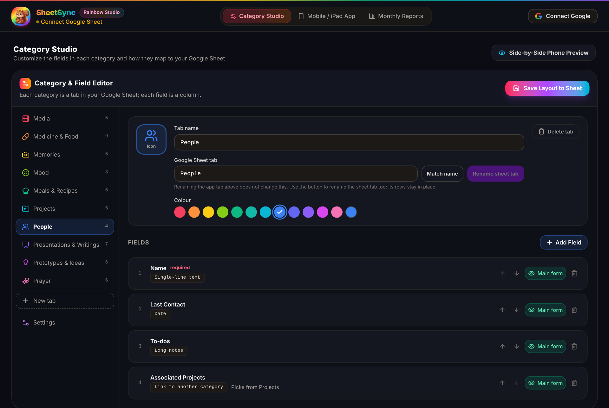
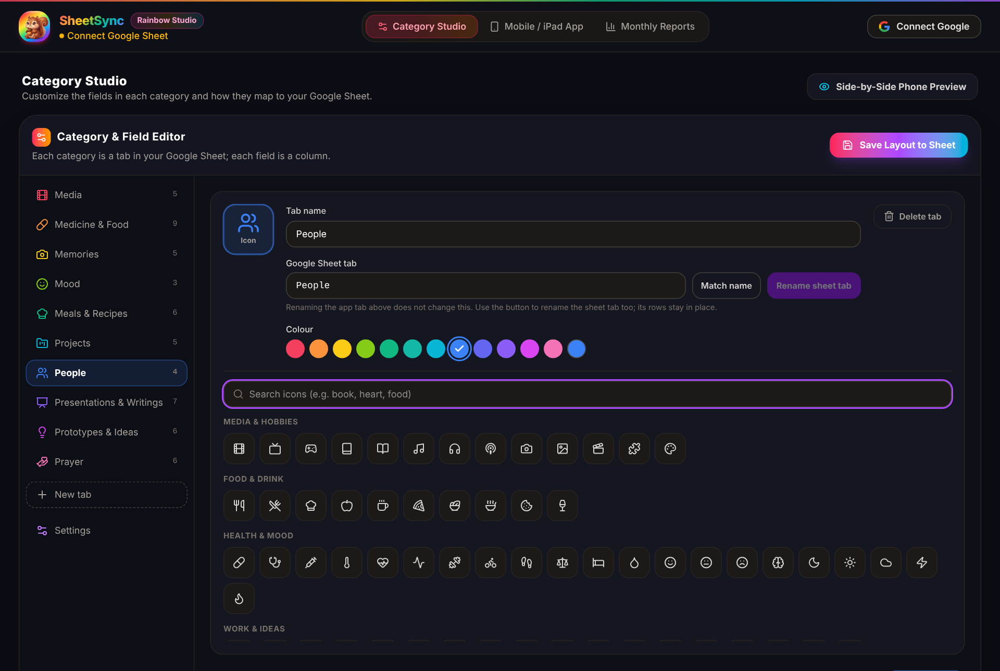

# SheetSync

SheetSync is a personal tracker that logs everyday life into your own Google Sheet. You log quickly from your phone, every category becomes a tab in the spreadsheet, and a monthly report summarises what you recorded.

Live app: <https://sherol.github.io/sheetsync/>

<p>
  
  
  
</p>

The screenshots use example data.

## Contents

- [Getting started](#getting-started)
- [The three views](#the-three-views)
- [Categories](#categories)
- [Logging entries](#logging-entries)
- [Field types](#field-types)
- [Bible study tracker](#bible-study-tracker)
- [Monthly report](#monthly-report)
- [Category Studio](#category-studio)
- [Resetting the sheet and backups](#resetting-the-sheet-and-backups)
- [How data is stored and synced](#how-data-is-stored-and-synced)
- [Related apps](#related-apps)
- [Development](#development)
- [License](#license)

## Getting started

1. Open the app. On a phone or tablet it opens in **Mobile / iPad App** view; on a wide screen it opens in **Category Studio**.
2. Select **Connect Google** and sign in. SheetSync asks for permission to edit spreadsheets it creates or opens.
3. Select the spreadsheet status under the SheetSync name in the top bar to open the spreadsheet dialog. SheetSync uses **one spreadsheet**, plus dated backups of it:
   - **First device:** on **Reset Sheet**, tap **Create SheetSync spreadsheet**. It creates a spreadsheet named "SheetSync" with your tabs (or the defaults), plus `Monthly_Reports` and `App_Config`.
   - **Other devices:** connect that same spreadsheet with **Choose from Drive**, or paste its URL or ID under **Enter ID / URL**.
4. Start logging. Entries also save on the device, so the app works before you connect a sheet; anything logged offline is sent once you connect.

## The three views

The switcher in the top bar moves between three views:

| View | What it's for |
|---|---|
| **Category Studio** | Edit tabs and fields: names, icons, colours, field types, order |
| **Mobile / iPad App** | Log and edit entries |
| **Monthly Reports** | See a month's summary and save it to the sheet |

The top bar always shows the brown squirrel next to the **SheetSync Rainbow Studio** name. Inside the app view, the header shows the white-outline squirrel, which is also the favicon.

## Categories

SheetSync starts with ten categories. Each one is a tab in the app and a tab in your Google Sheet. Each tab has a title such as "Media & Music"; tabs and lists show its first word ("Media"). Titles are editable in Category Studio.

| Tab · full title | Sheet tab | Fields |
|---|---|---|
| **Media** · Media & Music | `Media` | Title, Type (Book / Movie / TV / Game / Album), Date Consumed, Review, Links |
| **Medicine** · Medicine & Food | `Medicine` | Date, Time, Type (Med / Snack / Meal / Drink), Food / Drink / Activity, Amount, How do I feel?, Hunger Level 1–10, Burning Level 1–10, Stress 1–10 |
| **Memories** · Memories & Milestones | `Memories` | Date, Location, Who Was There, What Happened, Results |
| **Mood** · Mood & Feelings | `Mood` | Date, Mood Score 1–10, Daily Recap |
| **Meals** · Meals & Recipes | `Meals` | Name, Type, Ingredients, Directions, Last Cooked, Links |
| **Projects** · Projects & Practice | `Projects` | Name (from the Projects list), Type (from the Project types list), Date, About, Links |
| **People** · People & Friends | `People` | Name, Last Contact, To-dos, Associated Projects (from the Projects list) |
| **Presentations** · Presentations & Writings | `Presentations` | Title, About, Where, When, Who Was There, Slides, Links |
| **Prototypes** · Prototypes & Ideas | `Prototypes` | Name, Type, Date, Idea, Related Projects (from the Projects list), Links |
| **Prayer** · Prayer & Theology | `Prayer` | Date, Prayer, Book Studied, Chapters, Study Notes, Answered (Waiting / Answered) |

You can rename, recolour, reorder, add and delete categories and their fields in [Category Studio](#category-studio).

## Logging entries

The app opens on a **home list** of every category, top to bottom. Each row shows how many entries the category has and the date of the latest one.

- **Open a category:** tap its row. The screen shows the entry form, then that category's recent entries. **‹ All** returns to the list.
- **Save:** fill in the form and tap **Save to _category_**. Fields marked `*` are required; if one is empty, a red banner names it.
- **Defaults:** date fields start at today, and time fields start at the current time.
- **More fields:** fields set to "More fields" in the studio sit behind a **N more fields** toggle below the main form.
- **Edit:** tap the pencil on a recent entry to load it into the form, change it, then tap **Update entry**. In Google Sheets, an edit overwrites that entry's existing row instead of adding a new one, so you can keep records such as a person's "Last Contact" or a recipe's "Last Cooked" current.
- **Entries:** the category's entries, newest first, with their choices, coloured ratings and clickable links. The list shows 25 at a time and loads more as you scroll; once this device's own entries run out, it reads older entries from your Google Sheet a page at a time.

### Quick picks

Medicine & Food has **quick picks**: one-tap buttons for things you log often, such as "Vitamin D · 1000 IU".
- **Adding one:** fill in the item and anything you repeat (type, amount), then tap **Save "…" as quick pick**.
- **Using one:** tap it to fill in the type, item and amount. The date, time, ratings and notes stay as they are for this entry.
- **Edit** reorders or removes them.

Quick picks are saved with your tab setup, so every device has the same ones. Turn them on for other tabs in Category Studio ("Quick picks on this tab's form").

### Projects list

On the **Projects & Practice** tab:
- **Name** is a dropdown of your projects, so you can log another session on an existing one. Choose **＋ New project…** to type a new one; it joins the list.
- **Type** is a dropdown from a **Project types** list (Practice, App, Music, Writing, Side project to start). **＋ New project type…** adds one, and **Edit project types** manages the list. Types you'd already used are added automatically.

People's **Associated Projects** and Prototypes' **Related Projects** are dropdowns from the same shared **Projects** list:
- Pick a project to add it as a chip; tap ✕ on a chip to remove it.
- **Edit projects** opens the list right in the form: add, rename (tap a name), reorder or remove. Removing a project from the list doesn't change entries that already use it.
- Saving an entry in the Projects tab adds its name to the list. Projects already logged on a device are added the first time it opens this version.
- The list is saved with your tab setup, so it's the same on every device.

<p>
  
  
</p>

## Field types

| Type | What you see | Stored in the sheet as |
|---|---|---|
| Single-line text | A text box | Text |
| Long notes | A larger text box | Text |
| Number | A number box, with an optional unit | Number |
| Rating scale | A row of numbered buttons coloured **green (lowest) → yellow → orange → red (highest)**; tap the selected one again to clear it | Number |
| Choice | Buttons for each option, or a dropdown for long lists | Text |
| Date | A date picker | `YYYY-MM-DD` |
| Time | A time picker | `HH:MM` |
| Links | One link per line; shown as clickable links in recent entries | Text |
| Dropdown from a shared list | A dropdown of a list's items (e.g. Projects), with **Edit list** to change the list. Optionally several picks shown as chips, and **＋ New…** to add an item while logging | Text (comma-separated when several) |
| Link to another category | Tap-to-pick buttons of entries in another category, plus a text box for anything else | Comma-separated names |

## Bible study tracker

The Prayer category includes a Bible study tracker.

- **Recording study:** each Prayer entry can record a **Book Studied** (any of the 66 books) and **Chapters**, written as `1-3, 5`, `12` or `all`. A blank Chapters field marks the book as started without counting any chapters.
- **Progress map:** shows chapters studied out of 1,189, books started out of 66, and books finished. It lays out every book under Old and New Testament, shaded by how much of it you've covered.
- **Book details:** tap a book to see each chapter marked done or not, and how many sessions you've logged on it.

The tracker appears on the Prayer screen and at the bottom of the monthly report.


## Monthly report

**Monthly Reports** covers the month you pick from the selector. The selector lists every month that has entries, plus the current month. All numbers come from what you logged; an empty month shows "—" rather than an estimate.

- **Totals:** entries logged, average mood, days with a mood entry, and Bible chapters studied that month.
- **Summary:** a few plain sentences, such as the busiest category, the mood range, and food averages.
- **Daily mood:** a bar chart coloured on the same green-to-red scale as the mood buttons.
- **Entries by category:** a bar for each category.
- **Details:** the average of every other rating field, such as Hunger, Burning and Stress, plus counts for choice fields (e.g. Media by type).
- **Bible Study Progress:** all-time, at the bottom of the report.



**Save Report to Sheet** adds a row to the `Monthly_Reports` tab with the month, entry count, average mood, counts by category and the summary.

## Category Studio

The studio is where you change what you track. A sidebar lists the categories; select one to edit it.



### Tab settings

- **Icon:** tap the large icon square to open the icon library. It has about 100 icons in six groups (Media & Hobbies, Food & Drink, Health & Mood, Work & Ideas, People & Places, Faith & Life) and a search box.
- **Title:** for example "Media & Music". It's the form heading and shows under the name on the home screen. Its first word ("Media") names the tab in the app **and** the tab in your Google Sheet.
  - Change the title and the sheet tab is renamed in the spreadsheet on the next sync, keeping all its rows. The studio shows "renamed from … on the next sync" until then.
  - If two tabs would get the same first word, the second sheet tab gets a number (`New`, `New_2`).
- **Colour:** pick one of 12 swatches, or any custom colour.
- **Delete tab:** removes the category and its entries from this device, after you confirm. The tab in Google Sheets is not touched.



**+ New tab** in the sidebar creates a category with Name, Date and Notes fields, ready to rename and extend.

### Fields

- **Add Field** has a name, a type (see [Field types](#field-types)), a "Show on main form" switch and a Required switch. Some types have extra settings:
  - Choice: its options.
  - Number: a unit.
  - Rating scale: lowest and highest values.
  - Dropdown from a shared list: which list (or a new one), whether several picks are allowed, and whether **＋ New…** is offered.
  - Link to another category: which category to pick from.
- **Edit** (pencil icon) opens a field in the same form, so you can change its name, type, choices, unit, scale, linked category, Required and Main form. The field keeps its identity, so entries already logged stay with it, and its sheet column header updates on the next save. The Prayer tab's Book Studied and Chapters fields keep their types because the Bible tracker reads them.
- **↑ / ↓** reorder fields, which is also their column order in the sheet.
- **Main form / More fields** chooses whether a field shows immediately or behind the "more fields" toggle.
- **Delete** (bin icon) removes a field after you confirm.

### Settings

**Home Screen Order** sets the order of the categories on the app's home list.

Your setup is backed up to the `App_Config` tab automatically a couple of seconds after each change, while you're connected. **Save Layout to Sheet** backs it up right away.

## Resetting the sheet and backups

SheetSync keeps **one spreadsheet**. Resets and restores change that same file, so every device stays connected to it, and copies go into a `backup` folder in your Google Drive. Tap the spreadsheet name in the top bar to find both.

### Reset Sheet

The first tab of the spreadsheet dialog. Choose the tabs and fields:
- **Keep the current schema:** the same tabs, names, icons and fields you have now.
- **Start with a new schema:** the default ten tabs, ready to customise.

Tick the confirmation and tap **Back up and reset**. SheetSync then:
1. copies the spreadsheet into `backup/`, named with the date and time first (e.g. `2026-10-20 03.30 SheetSync`), unless nothing has changed since the last backup.
2. empties the same spreadsheet and rebuilds it with the chosen tabs, saving the layout to `App_Config`. Other devices pick up the new layout on their next sync.
3. clears this device's entry list, so old entries aren't sent again. They're in the backup.

If the backup step fails, nothing is changed. With no spreadsheet connected yet, the same button creates the SheetSync spreadsheet instead.

### Backups

The **Backups** tab lists the spreadsheets in `backup/`, newest first. Each has a link to open it in Google Sheets, and **Load** replaces the contents of your SheetSync spreadsheet with that backup (values and formatting, tab by tab). Before loading, the current contents are backed up the same way, unless nothing has changed since the last backup. The backup's tabs and fields become your layout, and this device's entry list is cleared.

### Changed since backup

`App_Config` holds a `changed_since_backup` flag. SheetSync sets it to `TRUE` the first time it writes an entry, the layout or a tab rename after a backup, and to `FALSE` after a reset or a restore. Reset and Load skip the backup only when it's `FALSE`. Edits you make directly in Google Sheets don't set the flag, so a manual edit right after a reset isn't treated as a change.

## How data is stored and synced

SheetSync keeps a copy on the device, sends every entry to your Google Sheet, and shares the category setup between devices through the sheet.

- **On the device:** entries and settings are saved in the browser's local storage, so the app works offline and before you connect.
- **Sending:** every save is sent to the category's tab when you're connected. Anything saved while offline or signed out is kept as **unsent**. The badge next to the sheet name shows how many entries haven't been sent yet. They're sent automatically when you connect, when the network comes back, or when you tap the badge.
- **Shared setup:** your tabs, fields, icons, colours and home order are kept in the `App_Config` tab. When you connect, and when you come back to the app after a minute or more, SheetSync reads only that tab: a device that hasn't changed its own setup takes the sheet's, otherwise the newer setup wins. Change a tab on your laptop and the iPad shows the same tabs next time.
- **Entries load page by page:** SheetSync doesn't download the whole sheet. Opening a category reads its newest 25 rows from the sheet, and scrolling to the end of the list reads the next 25 older rows, until the top of the tab.
  - Rows on a page are merged into the device by ID, and the newer **Saved At** wins. That brings in entries from other devices and edits made in mdlife or directly in Google Sheets.
  - Entries that have been loaded stay on the device. Entries you haven't scrolled to aren't loaded, so the home screen counts and monthly reports only include entries on this device.
  - If rows are inserted or deleted in the sheet while you scroll, SheetSync finds the last row it read again by its ID and carries on from there (or starts again from the newest rows if that row was deleted), so no entry is skipped or listed twice.
  - Resetting the sheet or loading a backup starts the open category's list again from the newest rows.
  - If Google can't read a tab for any reason other than the tab not existing, the list shows the error instead of stopping quietly.
- **In the sheet:** each row has **ID**, **Saved At**, then one column per field in the studio's order.
  - Rows are matched by ID, so editing an entry updates its row.
  - Text is stored exactly as typed. For example, chapters like `1-3` stay text instead of turning into a date.
- **Staying connected:** Google sign-in lasts about an hour and survives reloading the page, until you close the tab. When it runs out, or you open SheetSync again after closing the tab, the header still shows your Google account with **Reconnect** (until you sign out). Your entries are kept and sent once you reconnect.
- **Switching spreadsheets:** connecting a different spreadsheet sends every entry on the device to it. Normally you won't need to: Reset and Load change the one SheetSync spreadsheet in place.
- **Changing fields later:** reordering or deleting fields changes the header row, but rows already in the sheet keep their original column positions.
- **Older versions of SheetSync:** if you used the earlier Life / Health / Prayer / Habits version, your connected spreadsheet stays linked. Its old tabs are left untouched, and the new category tabs are added beside them.

## Related apps

- **[mdlife](https://github.com/sherol/mdlife)** can open your SheetSync spreadsheet as a note: it shows the tabs and entries and lets you edit or add rows. It reads the layout from `App_Config` and matches rows by **ID**, writing **Saved At** the same way SheetSync does, so its edits show up here when the category's page is next read.
- **[bookclub](https://github.com/sherol/bookclub)** signs in with Google through SheetSync's Firebase project. It keeps its own spreadsheet and doesn't read SheetSync's.

## Development

Requirements: Node.js 20.19+ or 22.12+ (what Vite 8 needs). The repo has a `bun.lock`; CI installs with npm.

```bash
npm install      # or: bun install
npm run dev      # dev server on http://localhost:3000
npm run lint     # type check (tsc --noEmit)
npm test         # unit tests (vitest)
npm run build    # production build in dist/
npm run preview  # serve the production build
npm run clean    # remove dist/
```

### Google sign-in and configuration

There are no environment variables or secrets to set. Sign-in uses Firebase Auth with Google as the provider; the Firebase web config is in `src/services/auth.ts` (these values are public and identify the project).

SheetSync asks for two scopes: `spreadsheets` (read and write any spreadsheet you connect, including by ID / URL) and `drive.file` (Drive access only to files SheetSync created). So **Choose from Drive**, the `backup` folder and backups list only files SheetSync made, and backing up a spreadsheet SheetSync didn't create fails with a message saying so.

The Firebase project is shared with bookclub. For sign-in to work on a new domain, add it under Firebase **Authentication → Settings → Authorized domains** (`sherol.github.io` and `localhost` are needed for the live app and `npm run dev`).

### Project layout

| Path | Contents |
|---|---|
| `src/config/categories.ts` | The default categories, the rating colour scale, entry title/date helpers |
| `src/config/bible.ts` | The 66 books with chapter counts, chapter parsing, progress maths |
| `src/types/index.ts` | Shared types: categories, fields, entries, lists, quick picks, app config |
| `src/services/sheetsService.ts` | Google Sheets and Drive API calls: create, add tabs, read tabs and pages, write rows, rename tabs, reset, backups and restore, reports |
| `src/services/syncEngine.ts`, `syncLogic.ts` | Sync: the shared layout in `App_Config`, sending unsent entries in batches, loading a category's entries a page at a time (`loadEntriesPage`) |
| `src/hooks/useSheetSync.ts` | When sync runs: on connect, after saves and layout edits, on return to the app, when back online |
| `src/services/storageService.ts` | Local storage, and migration from older saved settings (`SCHEMA_VERSION`, `upgradeCategories`) |
| `src/services/auth.ts` | Google sign-in through Firebase Auth; the token is kept for the tab until it expires |
| `src/App.tsx` | App state, sign-in, saving entries, reset and backup flows |
| `src/components/Navbar.tsx` | Top bar: spreadsheet name, sync badge, view switcher, sign-in |
| `src/components/SpreadsheetModal.tsx` | Spreadsheet dialog: Reset Sheet, Backups, Choose from Drive, Enter ID / URL |
| `src/components/MobileView.tsx` | Home list, entry form, the category's entries (loaded page by page) |
| `src/components/DesktopStudio.tsx`, `CategorySettings.tsx` | Category Studio |
| `src/components/FieldInput.tsx` | One input component for every field type |
| `src/components/ListPicker.tsx` | Dropdown from a shared list (e.g. Projects), with its inline list editor |
| `src/components/QuickPicks.tsx` | Quick-pick buttons on a form |
| `src/components/MonthlyReportView.tsx` | Monthly report |
| `src/components/BibleProgress.tsx` | Bible study progress map |
| `src/services/__tests__/` | Unit tests for sync, paging, backups, sign-in after a reload |
| `public/favicon.svg` | The white-outline squirrel; the build embeds it in `index.html` |
| `public/squirrel-icon.png` | The brown squirrel in the top bar |

### Deployment

Pushing to `main` runs `.github/workflows/deploy.yml`, which builds the app and publishes `dist/` to GitHub Pages.

In the repository's **Settings → Pages**, set **Source** to **GitHub Actions**. If it's set to "Deploy from a branch", GitHub also publishes the unbuilt source files. They can overwrite the built app, which shows up as a blank page or a missing favicon.

## License

Apache License 2.0. See [LICENSE](LICENSE).
